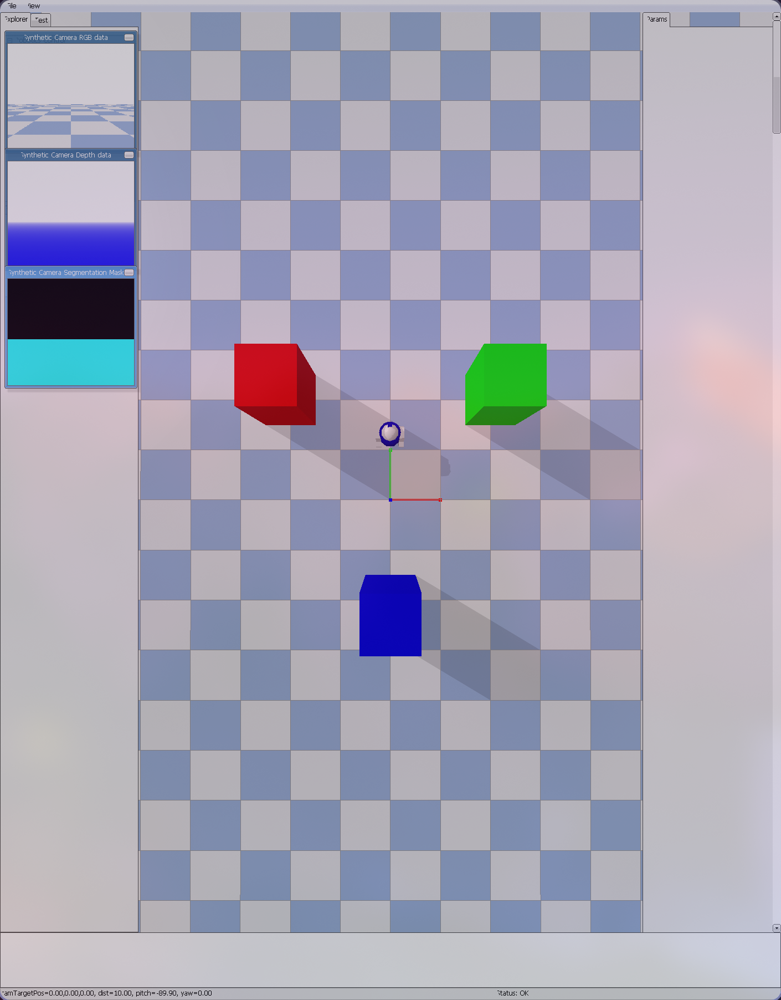

# Seminar: Operating Complex IT systems

The repository explores the usage of relative coordinates for a LLM-controlled robot. 
The idea is to provide a LLM with a simple api to control a robot, giving it [tasks](#experiments) to complete in the environment.

See [Results](#results) to compare the performance of different models.
For more info, read the report or skim the slides in the [release](https://github.com/NilsDeckert/SEOCITS/releases/tag/Submission).

## Usage

Install requirements, export API keys, then run the `main.py` script:
```bash
export AZURE_OPENAI_API_KEY=xxx
export GOOGLE_GENAI_API_KEY=xxx
pip install -r requirements.txt
python main.py
```

## Project Structure
```
- llm: Wrappers to interact with LLMs
 - reviewer.py: Review plans made by class below
 - openai.py: Main class to get robot control commands
- simulation/: Simulation environment
- robot/: Robot API and sensors
 - sensors/: Available robot sensors
 - simple_robot.py: Simple robot API wrapper
- config.py: File to save and edit settings
- main.py: Main script
```



## Experiments

In order to test the LLMs reasoning capabilities using relative coordinates, the model is tested on multiple tasks with approximately increasing complexity.
The table below lists the benchmarked tasks.

Tasks 1-3 are meant to ensure that the model is capable of the basic controls necessary to complete more complex tasks.
Task 4 requires 'understanding' of the simplified sensor readings and the deduced environment.
Finally, Task 5 combines the requirements necessary for the prior tasks and demands 'understanding' of the location changes caused by the robots' movements.

| Short |                                                                   Description                                                                   |
|-------|:-----------------------------------------------------------------------------------------------------------------------------------------------:|
| Turn Left |                                                              Turn left 90 degrees                                                               |
| Turn Right |                                                              Turn right 90 degrees                                                              |
| Walk Back and Forth | Walk 3 meters forward, then turn around and walk back to you original position. Turn around until you are facing your starting position again.  |
| Touch Red |                                                              Touch the red circle                                                               |
| Circle Green |                                                             Touch the green circle                                                              |

## Results

### Success rate

**Table II: Success rate per model per task**

| Model                  | Turn Left | Turn Right | Walk Back and Forth | Touch Red | Circle Green |
|------------------------|-----------|------------|---------------------|-----------|--------------|
| GPT 5 Mini             | 20/20     | 20/20      | 20/20               | 20/20     | 9/20         |
| GPT 5.3 Chat           | 20/20     | 20/20      | 20/20               | 20/20     | 8/20         |
| Deepseek V3.2          | 20/20     | 20/20      | 20/20               | 19/20     | 9/20         |
| Kimi K2.5              | 20/20     | 20/20      | 20/20               | 20/20     | 8/20         |
| Gemini 3.1 Flash Lite  | 20/20     | 20/20      | 20/20               | 19/20     | 6/20         |
| Gemini 3.5 Flash       | 20/20     | 20/20      | 20/20               | 19/20     | 8/20         |
| Gemini 3.1 Pro Preview | 20/20     | 20/20      | 20/20               | 19/20     | 5/20         |
| Gemini 4 Argon         | TBD       | TBD        | TBD                 | TBD       | 20/20        |

**Table III: Median latency per model per task**

| Model                  | Turn Left (s)     | Turn Right (s)   | Walk Back and Forth (s) | Touch Red (s)   | Circle Green (s) |
|------------------------|-------------------|------------------|-------------------------|-----------------|------------------|
| GPT 5 Mini             | 4.44              | 4.53             | 10.02                   | 6.56            | 12.66            |
| GPT 5.3 Chat           | 4.58              | 4.69             | 8.76                    | 5.99            | 14.39            |
| Deepseek V3.2          | 4.68              | 4.07             | 9.14                    | 7.21            | 15.89            |
| Kimi K2.5              | 4.42              | 4.02             | 9.06                    | 6.62            | <ins>12.2</ins>  |
| Gemini 3.1 Flash Lite  | 4.69              | 4.18             | 8.77                    | 6.37            | 14.37            |
| Gemini 3.5 Flash       | 4.06              | <ins> 3.86 </ins> | 9.03                    | <ins>5.85</ins> | 14.31            |
| Gemini 3.1 Pro Preview | <ins> 3.95 </ins> | 4.01             | <ins>8.72</ins>         | 6.52            | 13.91            |
| Gemini 4 Argon         | TBD               | TBD              | TBD                     | TBD             | 12.61            |